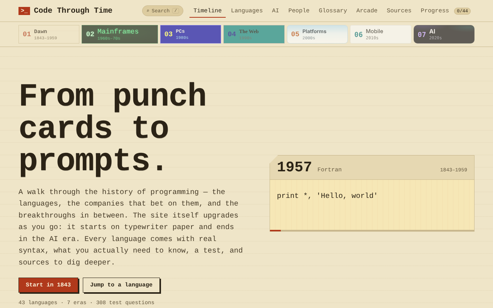
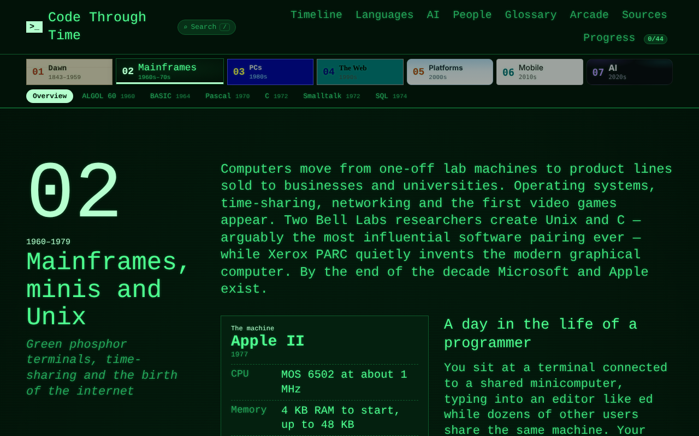
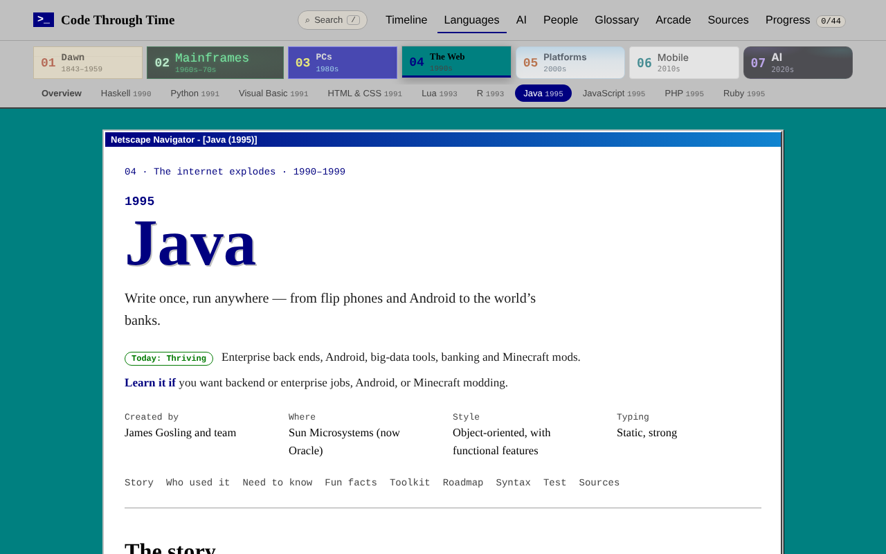
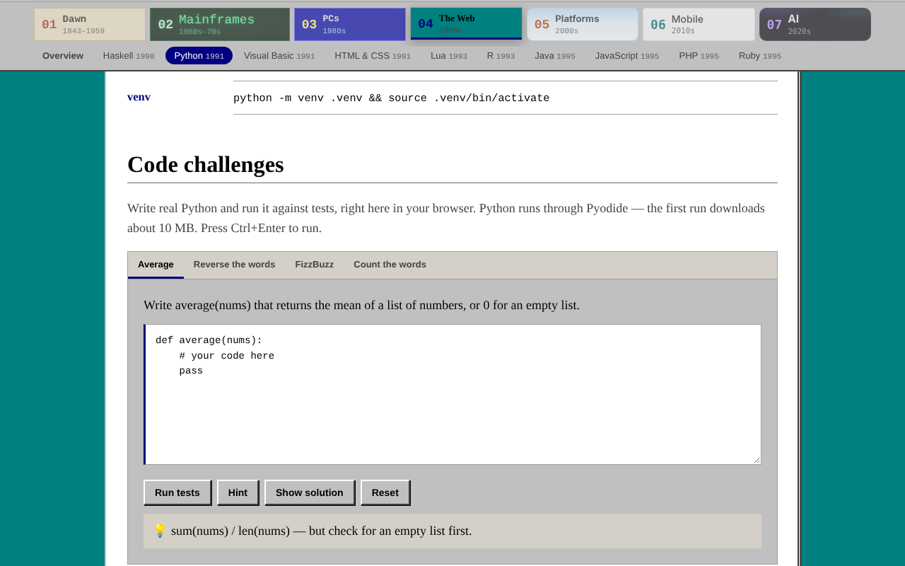
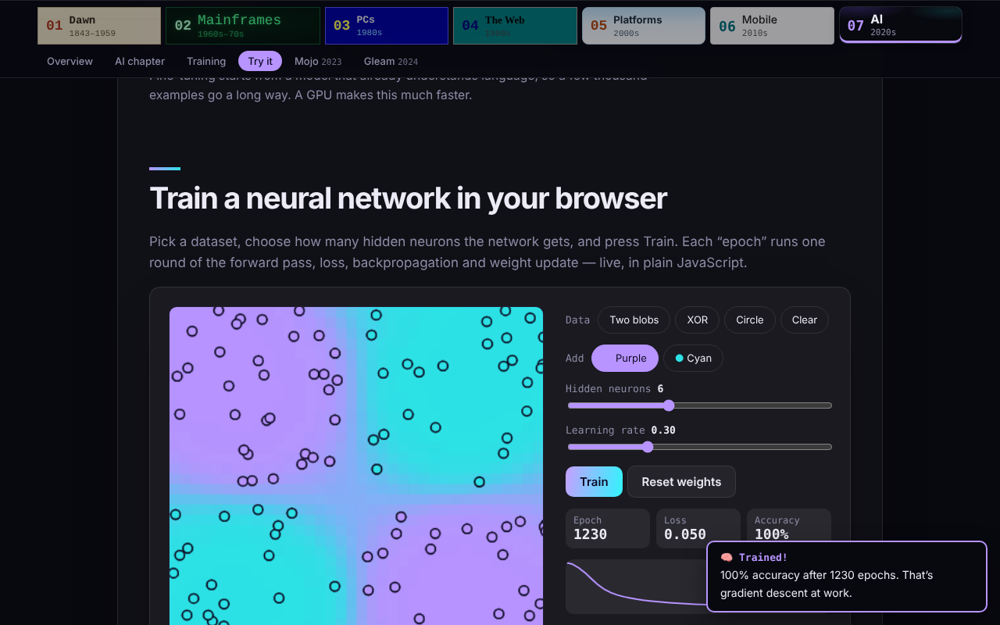

# Code Through Time

**▶ Live site: https://samappl.github.io/Code-Through-Time/**

An interactive history of programming — from Ada Lovelace’s first algorithm and hand-written assembly to Rust, Mojo and coding with AI. The site itself travels through time: it starts on typewriter paper, turns into a green phosphor terminal, a DOS screen, Windows 95, glossy Web 2.0, flat Material design and finally the AI era.

Built with plain **HTML, CSS and JavaScript**. No frameworks, no build step.



## What’s inside

- **7 eras** (1843 → today), each with breakthroughs, a games and phones timeline, the machine of its time, a day in the life of a programmer, and sources.
- **Era tabs on every page** — jump to any era; a second row lists that era’s languages.
- **43 languages**: Assembly, Fortran, Lisp, COBOL, ALGOL 60, BASIC, Pascal, C, Smalltalk, SQL, Ada, Objective-C, MATLAB, C++, Perl, Bash, Haskell, Python, Visual Basic, HTML & CSS, Lua, R, Java, JavaScript, PHP, Ruby, C#, ActionScript, Scala, PowerShell, Go, Kotlin, Dart & Flutter, Elixir, Julia, TypeScript, Swift, Solidity, GDScript, Rust, Zig, Mojo and Gleam. Each has its story, who used it, what you need to know, real syntax, fun facts with sources, and where it stands today.
- **Deep dives** for the most-used languages (Python, Java, JavaScript, C#, C, C++, SQL, PHP, Ruby, Lua, Go, Kotlin, TypeScript, Swift, Rust, Dart, Bash, PowerShell): the modern toolkit, common pitfalls, a learning roadmap and project ideas.
- **308 test questions** — multiple choice, predict-the-output, spot-the-bug and type-the-syntax. Answers are shuffled every time, and you can review what you missed.
- **Coding challenges you run in the browser** — JavaScript in a sandboxed worker, Python through [Pyodide](https://pyodide.org/).
- **The AI chapter**: history, how models are trained, runnable training code, a **neural network you can train live in your browser**, coding with AI safely, and a learning path.
- **People** (24 pioneers), a **glossary** (52 terms) and **search** (press <kbd>/</kbd> or <kbd>Ctrl</kbd>+<kbd>K</kbd>).
- **Arcade**: a punch card maker using real IBM 029 hole codes, Nokia-style Snake, and *Guess the Language*.
- **Ranks, 17 achievements**, era-themed quiz reactions (“?SYNTAX ERROR”, “Abort, Retry, Fail?”, “Hallucination detected”), a BIOS boot screen and a secret code (↑↑↓↓←→←→BA).
- **300+ sources** collected on the Sources page — every fun fact links to its own source.
- **Progress** saved in your browser, with export/import to move it between devices.

| | |
| --- | --- |
|  |  |
|  |  |

## Run it locally

```bash
python3 -m http.server 8000
# open http://localhost:8000
```

Opening `index.html` directly also works, but the Python coding challenges need a local server or GitHub Pages.

## Publish on GitHub Pages

```bash
git init
git add .
git commit -m "Code Through Time"
git branch -M main
git remote add origin https://github.com/YOUR-USERNAME/code-through-time.git
git push -u origin main
```

Then on GitHub: **Settings → Pages → Build and deployment → Source: Deploy from a branch → `main` / `(root)`**.

After it’s live:
1. Replace every `YOUR-USERNAME` in this README, `CONTRIBUTING.md` and `index.html` with your GitHub username.
2. In `index.html`, make `og:image` an absolute URL (`https://YOUR-USERNAME.github.io/code-through-time/assets/social-preview.png`) so link previews work on Discord and LinkedIn.
3. Optional: upload `assets/social-preview.png` under **Settings → General → Social preview**.

## Work offline / self-host fonts and syntax colours

By default, fonts load from Google Fonts and syntax highlighting from a CDN. To bundle them into the repo:

```bash
node tools/vendor-assets.mjs           # downloads into vendor/ and switches index.html to local files
node tools/vendor-assets.mjs --revert  # switch back to the CDNs
```

(In-browser Python, about 10 MB, always loads from the Pyodide CDN on first use.)

## Tests and automation

```bash
node tests/validate.mjs
```

Checks every language, era, quiz answer, fact source and coding-challenge solution (JavaScript and, if installed, Python). GitHub Actions runs it on every push (`.github/workflows/ci.yml`) and checks all 300+ source links every week (`.github/workflows/links.yml`).

## Project structure

```
code-through-time/
├── index.html
├── css/style.css                 # all styling; one theme per era ([data-theme="…"])
├── js/
│   ├── app.js                    # router, pages, era tabs, quizzes, search, progress
│   ├── fun.js                    # ranks, achievements, toasts, confetti, boot screen, secret code
│   ├── arcade.js                 # punch card maker, Snake, Guess the Language
│   ├── trainer.js                # the in-browser neural network trainer
│   ├── lab.js                    # coding challenges (JS worker + Pyodide)
│   └── data/                     # ALL content lives here
│       ├── 00-eras.js
│       ├── 01-…07-*.js           # languages
│       ├── 05-ai.js              # the AI chapter
│       └── 08-people-glossary-challenges.js
├── tests/validate.mjs            # content checks (no dependencies)
├── tools/vendor-assets.mjs       # self-host fonts + Prism
├── docs/screenshots/
├── assets/                       # favicon, social preview
└── .github/                      # CI, link checker, issue and PR templates
```

## Adding a language

Add an object to one of the `js/data/*.js` files and run `node tests/validate.mjs` — it tells you anything that’s missing. See [CONTRIBUTING.md](CONTRIBUTING.md) for the full checklist.

```js
CT.langs["nim"] = {
  id: "nim", name: "Nim", year: 2008, era: "platform", level: "core",   // classic | core | modern
  creator: "Andreas Rumpf", org: "Open source", paradigm: "Multi-paradigm", typing: "Static",
  prism: "nim", tags: ["systems"], tagline: "One-line summary.",
  story: ["…"], usedBy: [{ who: "…", what: "…" }], know: ["…"],
  examples: [{ title: "Hello", code: `echo "Hello"`, note: "" }],
  facts: [{ text: "…", src: { t: "Title", u: "https://…" } }],          // at least 3
  today: { status: "Niche", text: "…" }, learnIf: "…",
  quiz: [{ type: "mc", q: "…?", options: ["A", "B"], answer: 0, explain: "…" }],
  sources: [{ t: "Official docs", u: "https://…" }],
};
```

Then add its `id` to the right era’s `langs` list in `00-eras.js` (in year order).

## Notes

- Code examples for C, C++, Go, Rust, Python, Java, PHP, Perl, Ruby, TypeScript and the scikit-learn / pure-Python AI examples were compiled or run. Examples for languages without a local toolchain at the time (for example Haskell, Ada, R, Zig, Mojo, Gleam and the PyTorch training loop) were written carefully but not executed — corrections welcome.
- Mojo and Zig are pre-1.0 and change quickly; check their docs if an example stops compiling.

## Licence

MIT — see [LICENSE](LICENSE).
